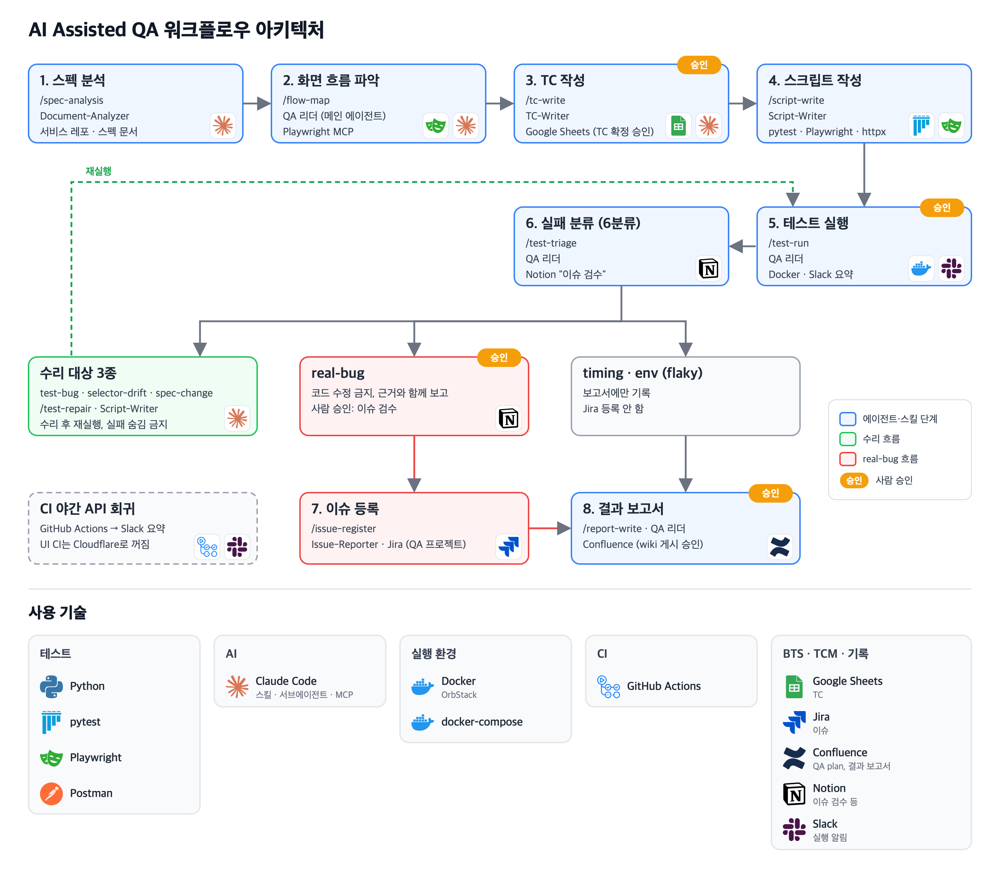

# AI-assisted Personal QA Project

AI 에이전트 기반 워크플로우를 설계하여 QA 프로세스를 구축한 프로젝트입니다.<br>
이 프로젝트에서는 테스트 연습용 웹 애플리케이션을 대상으로 E2E UI 및 API QA를 수행합니다.

## 1. 프로젝트 소개

- **대상 서비스**: [Practice Software Testing — Toolshop v5.0](https://practicesoftwaretesting.com)
  - 테스트 연습용 쇼핑몰 데모 사이트이며, 기획과 스펙은 [공개 저장소](https://github.com/testsmith-io/practice-software-testing)를 기준으로 합니다.

- **목적**
  - AI를 활용해 자동화 QA 프로세스와 업무 파이프라인을 설계하고, 개선점을 찾아 계속 고도화합니다.
  - AI를 단순 자동화와 효율화 도구로 쓰는 데 그치지 않고, 비즈니스 리스크에 집중해 결함을 효과적으로 찾고 예방하는 데 활용합니다.

<br>
<br>

## 2. AI 기반 QA 워크플로우

```txt
스펙 분석 → TC 작성 → 스크립트 작성 → 테스트 실행 → 실패 분류·수리 → 이슈 등록·결과 보고서 → CI 회귀 테스트
```



- 각 단계는 Claude Code의 스킬과 서브에이전트로 나눠 두었습니다.
  - 스킬: `/이름`으로 실행하는 작업 절차
  - 서브에이전트: 한 가지 역할만 맡아 독립된 맥락에서 일하는 AI

- 사람은 되돌리기 어려운 단계에서만 승인합니다.
  - TC 확정, 전체 테스트 실행, Jira 등록, wiki 게시, 커밋과 PR

<br>

### 2-1. AI 에이전트

- **메인 에이전트**
  - QA 리더: 테스트 실행, 실패 분석, 결과 보고를 직접 맡고 서브에이전트에 일을 나눠 줍니다.

- **서브에이전트**

| 서브에이전트 | 역할 |
| --- | --- |
| Document-Analyzer | • 스펙과 서비스 소스 분석<br>• 기능 목적, 핵심 흐름, 리스크, 테스트 범위 정리<br>• 서비스가 바뀌면 영향 범위 분석 |
| TC-Writer | • QA plan, 분석 정리된 스펙 문서를 읽고 TC 작성 |
| Script-Writer | • 확정된 TC를 바탕으로 테스트 스크립트 작성<br>• 실패한 테스트를 원인에 맞게 수정 |
| Issue-Reporter | • 사람이 승인한 결함을 Jira 버그 이슈로 등록<br>• 이슈 넘버를 기록 |

<br>

### 2-2. 단계별 스킬

| 순서 | 단계 | 스킬 | 담당 | 산출물 |
| --- | --- | --- | --- | --- |
| 1 | 스펙 분석 | `/spec-analysis` | Document-Analyzer | 기능별 리스크와 테스트 범위 분석 문서 |
| 2 | 화면 흐름 파악 | `/flow-map` | QA 리더 | 실제 화면 기준 흐름 지도 |
| 3 | TC 작성 | `/tc-write` | TC-Writer | 구글 시트 TC |
| 4 | 스크립트 작성 | `/script-write` | Script-Writer | 테스트 스크립트 |
| 5 | 테스트 실행 | `/test-run` | QA 리더 | 결과 리포트, Slack 요약 메세지 |
| 6 | 실패 분류 | `/test-triage` | QA 리더 | 실패 분류 결과, 이슈 후보 문서 |
| 7 | 실패 수리 | `/test-repair` | Script-Writer | 수정한 코드와 수정 기록 |
| 8 | 이슈 등록 | `/issue-register` | Issue-Reporter | Jira 이슈 티켓 |
| 9 | 결과 보고서 | `/report-write` | QA 리더 | wiki 결과 보고서 |

<br>

### 2-3. 실패 분류 (triage)

테스트가 실패하면 먼저 아래 6가지 중 하나로 분류하고, 분류에 따라 다음 행동이 정해집니다.<br>
\* **수정 원칙**: assertion 삭제, skip, 임의 xfail로 실패를 숨기지 않음. 수정된 부분은 점검 스크립트로 검사

- **실제 결함**: 코드를 고치지 않고 근거와 함께 보고하며, 사람이 승인하면 Jira에 등록합니다.

  | 분류 | 의미 |
  | --- | --- |
  | **real-bug** | 테스트와 환경은 정상인데 서비스가 스펙과 다르게 동작 |

- **테스트 결함**: 아래 실패로 분류되면 Script-Writer가 테스트 스크립트를 수리합니다.

  | 분류 | 의미 |
  | --- | --- |
  | test-bug | 테스트 코드 문제 |
  | selector-drift | 화면 요소 문제 |
  | spec-change | 스펙 변경 문제 |

- **Flaky 이슈**

  | 분류 | 의미 |
  | --- | --- |
  | timing | 테스트 진행 중 대기 방식/시간에 의한 문제 |
  | env | 사이트 지연, 데이터 초기화 등 환경 문제 |

<br>
<br>

## 3. 결과

| 항목 | 결과 |
| --- | --- |
| TC | • UI 95건<br>• API 116건 |
| 자동화율 | 100% |
| 테스트 사이클 | • UI 및 API 각 Iteration 1~3 진행<br>• 사인오프 PASS |
| 발견한 결함 | • Jira 버그 13건 등록<br>• UI 7건, API 6건<br>• High 0건 |
| CI | • GitHub Actions에서 API 회귀 테스트 새벽 자동 실행<br>• Slack 결과 요약 알람 설정 |
| 결함 주입 검증 | 전체 탐지율<br>50.0% → TC 보강 후 84.6% |

- **결함 주입 검증이란?**
  - 서비스 레포에서 공식으로 제공하는 버그를 로컬 서비스에 하나씩 심고 AI가 만든 테스트가 결함을 실제로 잡는지 측정
  - AI 생성 테스트 실효성 검증을 목적으로 진행했으며, 하단 6.1 트러블 슈팅에서 상세 확인

<br>
<br>

## 4. 기술 스택

| 분야 | 도구 |
| --- | --- |
| 테스트 | • Python<br>• pytest<br>• Playwright<br>• Postman |
| AI | Claude Code: 스킬, 서브에이전트, MCP |
| 실행 환경 | • Docker(OrbStack)<br>• docker-compose |
| CI | GitHub Actions |
| BTS/TCM/기록 | • Google Sheets: TC<br>• Jira: 이슈<br>• Confluence: QA plan, 결과 보고서<br>• Notion: 이슈 검수 기타<br>• Slack: 실행 알림 |

<br>
<br>

## 5. 실행 방법

### 사전 준비

- Python 3.13 이상, Docker(Mac은 OrbStack도 가능)

- 테스트 계정
  - `playwright-demo/.env.example`, `api-demo/.env.example`을 같은 폴더에 `.env`로 복사하고 값을 채웁니다.
  - 계정은 서비스 저장소 README의 [Default accounts](https://github.com/testsmith-io/practice-software-testing#default-accounts)에 공개된 데모 계정을 사용합니다.

<br>

### 운영 데모 사이트를 대상으로 실행

```bash
docker build -t qa-tests .
# UI
docker run --rm -v "$PWD/playwright-demo:/qa/playwright-demo" -w /qa/playwright-demo qa-tests pytest -m "not spec_undefined"
# API
docker run --rm -v "$PWD/api-demo:/qa/api-demo" -w /qa/api-demo qa-tests pytest -m "not spec_undefined"
```

- 결과는 `playwright-demo/test-results/report.html`, `api-demo/test-results/report.html`에서 볼 수 있습니다.

<details>
<summary><b>선택: 로컬에서 Toolshop 실행</b></summary>

- **실행이 필요한 경우?**
  - 운영 데모 사이트는 응답이 느리고 데이터가 주기적으로 초기화됩니다.
  - 운영에서는 버그를 일부러 심거나, 품절 같은 테스트 조건 데이터를 만들 수 없습니다.
  - 같은 서비스를 로컬에 띄워 빠르게 돌리거나 조건을 만들어 확인할 때 실행합니다.

- **준비**
  - Docker를 실행해야 합니다. 아래 명령은 모두 터미널에서 순서대로 입력합니다.

- **1단계: Toolshop 서비스를 내 PC에서 실행**
  - [서비스 저장소](https://github.com/testsmith-io/practice-software-testing)를 내려받고, 운영 사이트와 같은 버전(sprint5)을 Docker 컨테이너로 실행합니다.
  - 터미널에 아래 명령어를 입력합니다.

```bash
git clone https://github.com/testsmith-io/practice-software-testing.git
cd practice-software-testing
echo "SPRINT=sprint5" > .env
docker compose -f docker-compose.yml up -d
```

<details>
<summary>명령어 설명</summary>

1. `git clone`: 서비스 저장소를 내 PC에 복사합니다.
2. `cd practice-software-testing`: 복사한 폴더로 들어갑니다.
3. `echo "SPRINT=sprint5" > .env`: 어떤 버전을 띄울지 정하는 설정 파일 `.env`를 만듭니다.
4. `docker compose -f docker-compose.yml up -d`: UI, API, DB 컨테이너를 백그라운드로 실행합니다. 처음에는 이미지 빌드와 패키지 설치 때문에 몇 분 걸립니다.

- 확인: `docker ps`에 `pst-`로 시작하는 컨테이너가 보이면 성공입니다. 아직 DB를 채우기 전이라 화면에 상품이 안 보일 수 있으니 2단계로 넘어갑니다.

</details>

- **2단계: 로컬 DB 초기화**
  - Personal_QA_project_with_AI 폴더로 돌아와 아래 명령 하나를 실행합니다.
  - 확인: 마지막에 `초기화 완료`가 나오면 [http://localhost:4200](http://localhost:4200)에서 쇼핑몰이 열리고, API는 [http://localhost:8091](http://localhost:8091)에서 응답합니다.

```bash
cd <이 저장소 폴더>
local/reset.sh
```

<details>
<summary><code>local/reset.sh</code>가 하는 일</summary>

- DB를 비우고 기본 상품과 계정 데이터(시드 데이터)를 채웁니다.
- API 캐시를 비웁니다. 옛 데이터가 남아 테스트가 잘못 실패하는 것을 막습니다.
- UI와 API가 응답하는지 확인합니다.

</details>

- **3단계: 로컬 Toolshop을 대상으로 테스트 실행**
  - Docker 컨테이너가 아닌 파이썬 가상환경에서 실행합니다. 테스트 컨테이너 안에서는 내 PC의 localhost에 접속할 수 없기 때문입니다.
  - 확인: 끝나면 각 폴더의 `test-results/report.html`에서 결과를 볼 수 있습니다.

```bash
# UI
cd playwright-demo
python3 -m venv .venv && source .venv/bin/activate
pip install -r requirements.txt && playwright install chromium
TOOLSHOP_SITE_URL=http://localhost:4200 TOOLSHOP_API_URL=http://localhost:8091 pytest --base-url http://localhost:4200
# API
cd ../api-demo
python3 -m venv .venv && source .venv/bin/activate
pip install -r requirements.txt
API_BASE_URL=http://localhost:8091 pytest
```

<details>
<summary>명령어 설명</summary>

1. `python3 -m venv .venv && source .venv/bin/activate`: 이 폴더 전용 파이썬 가상환경을 만들고 켭니다.
2. `pip install -r requirements.txt`: 테스트에 필요한 패키지를 설치합니다. UI는 `playwright install chromium`으로 테스트용 브라우저도 설치합니다. 1과 2는 처음 한 번만 하면 됩니다.
3. `TOOLSHOP_SITE_URL=... pytest ...`, `API_BASE_URL=... pytest`: 테스트 대상 주소만 로컬로 바꿔 실행합니다. 테스트 코드는 고치지 않습니다.

</details>

- **4단계(선택): 테스트 조건 데이터 만들기**
  - 품절 상품 같은 조건이 필요하면 저장소 폴더에서 `python3 local/seed_data.py out-of-stock --category hammer --count 2`처럼 만듭니다.
  - 확인이 끝나면 `local/reset.sh`로 처음 상태로 되돌립니다.

</details>

<br>
<br>

## 6. 트러블슈팅

<details>
<summary><b>6.1 테스트는 통과하나, 버그를 못 잡는 문제</b></summary>

- **문제**
  - 운영 사이트에서 테스트가 모두 통과해도 AI가 만든 테스트가 버그를 실제로 잡는지는 확인이 어려움
  - 버그를 놓치는 조용한 성공은 실패보다 위험하다고 판단

- **해결**
  - 서비스 레포에서 제공하는 버그 목록을 로컬 서비스에 주입하고 전체 테스트를 실행하여 탐지율 측정
  - 로그인 → 상품 조회 → 장바구니 → 결제 흐름을 범위로 지정 후, 흐름과 관련 없는 버그는 측정 제외
  - 놓친 버그는 원인을 네 가지로 분류
    - 테스트 스크립트 문제
    - 비슷한 TC가 있으나 조건이 다름
    - 비슷한 TC가 있으나 목적이 다름
    - 대응하는 TC가 없음

- **결과**
  - 원인별로 스크립트를 수정, TC를 보강해 탐지율을 50.0%에서 84.6%로 높임
  - 도메인 지식의 중요성과 AI 아웃풋을 객관적으로 측정하고 보완하는 과정의 중요성을 확인

</details>

<details>
<summary><b>6.2 운영 환경에서 만들 수 없는 테스트 조건</b></summary>

- **문제**
  - 재고는 API로 바꿀 수 없어 품절 상품 같은 조건은 운영에서 만들 수 없음
  - 운영에서 상품이 품절되자, 고정 상품을 담던 장바구니 테스트가 한꺼번에 실패

- **해결**
  - 테스트 스크립트는 수정하지 않고, 환경변수로 운영과 로컬 대상을 분리
  - 조건 데이터는 로컬에서만 생성하고 운영 데이터는 생성,삭제하지 않는 규칙 수립
  - 운영 테스트는 고정 상품 대신 재고가 있는 첫 상품을 고르도록 수정

- **결과**
  - 품절 영향을 받는 UI 테스트 48개가 운영 재고 상태와 관계없이 실행되도록 개선
  - 운영 데이터를 변경하지 않고 동일한 테스트를 두 환경에서 검증
    - 동일한 UI 테스트 59개 실행 시간: 운영 9.3분 → 로컬 3.0분

</details>

<br>
<br>

## 7. 문서

- [QA plan, 결과 보고서, 결함 주입 검증 문서] 하단 노션 페이지에서 확인 가능합니다.
(https://app.notion.com/p/404444852046805d926ee096a044911b)
